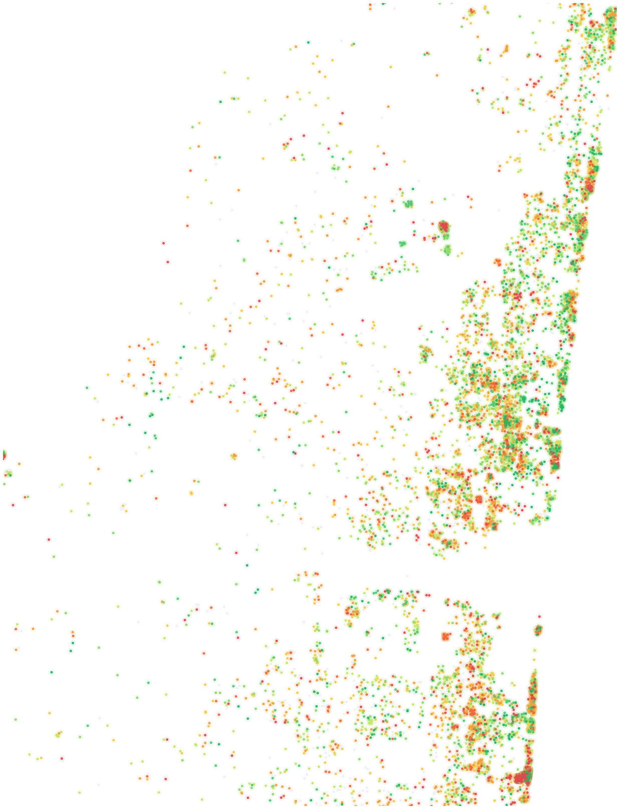

<!-- generated by tools/airbnb_build.py from the study's processed outputs; do not edit by hand -->
```{=html}
<div class="sv v-case">
  <section class="panel hero-glass brk case-hero" aria-labelledby="case-title">
    <div class="ch-text">
      <span class="eyebrow">Case study, Broward County, Florida</span>
      <h1 id="case-title" class="page-title">The best and worst bets in Broward Airbnb</h1>
      <p class="lede">What an entire-home rental really earns, and where.</p>
    </div>
    
    <ul class="stats" aria-label="Key numbers, entire homes, latest snapshot">
      <li class="stat"><span class="n">$60</span><span class="l">median RevPAR a night</span></li>
      <li class="stat"><span class="n">$22k</span><span class="l">median expected revenue a year</span></li>
      <li class="stat"><span class="n">24%</span><span class="l">of entire homes reach $50k</span></li>
      <li class="stat"><span class="n">38%</span><span class="l">of listings held by hosts with 10 or more</span></li>
    </ul>
  </section>
  <section class="panel rail-top case-view" aria-label="Charts">
    
    <div class="tabs" role="tablist" aria-label="Chart">
      <button class="tab" role="tab" id="t-map" aria-controls="v-map" aria-selected="true">The map</button>
      <button class="tab" role="tab" id="t-nb" aria-controls="v-nb" aria-selected="false">Neighbourhoods</button>
      <button class="tab" role="tab" id="t-tg" aria-controls="v-tg" aria-selected="false">Revenue targets</button>
      <button class="tab" role="tab" id="t-gr" aria-controls="v-gr" aria-selected="false">Growth</button>
      <button class="tab" role="tab" id="t-now" aria-controls="v-now" aria-selected="false">Market now</button>
    </div>
    <div class="tabpanel cv" role="tabpanel" id="v-map" aria-labelledby="t-map">
      <div class="mapwrap inlay"></div>
      <div class="cv-side">
        <span class="eyebrow">RevPAR a night, each colour a sixth of homes</span>
        <ul class="legend"><li><span class="sw" style="background:#4A7BE0" aria-hidden="true"></span>under $10</li><li><span class="sw" style="background:#2E9BD6" aria-hidden="true"></span>$10 to $30</li><li><span class="sw" style="background:#33C2C9" aria-hidden="true"></span>$30 to $60</li><li><span class="sw" style="background:#6FDDA6" aria-hidden="true"></span>$60 to $101</li><li><span class="sw" style="background:#B9EE7E" aria-hidden="true"></span>$101 to $180</li><li><span class="sw" style="background:#FFF27A" aria-hidden="true"></span>$180 and up</li></ul>
        <div class="btn-row"><button class="btn" type="button" popovertarget="tw-map">Table</button><button class="btn" type="button" popovertarget="n-method">Method</button></div>
      </div>
    </div>
    <div class="tabpanel cv" role="tabpanel" id="v-nb" aria-labelledby="t-nb" hidden>
      <div class="cv-chart"><span class="eyebrow">Median RevPAR, the 6 strongest and 4 weakest of 19 neighbourhoods</span><ul class="hbars dense" tabindex="0">
<li><span class="hb-l">Lighthouse Point<small>91 homes</small></span><span class="hb-t" aria-hidden="true"><span class="hb-f" style="width:100.0%"></span></span><span class="hb-v">$113</span></li>
<li><span class="hb-l">Pembroke Pines<small>143 homes</small></span><span class="hb-t" aria-hidden="true"><span class="hb-f" style="width:68.2%"></span></span><span class="hb-v">$77</span></li>
<li><span class="hb-l">Davie<small>102 homes</small></span><span class="hb-t" aria-hidden="true"><span class="hb-f" style="width:67.2%"></span></span><span class="hb-v">$76</span></li>
<li><span class="hb-l">Pompano Beach<small>1,635 homes</small></span><span class="hb-t" aria-hidden="true"><span class="hb-f" style="width:66.2%"></span></span><span class="hb-v">$75</span></li>
<li><span class="hb-l">Lauderdale By The Sea<small>392 homes</small></span><span class="hb-t" aria-hidden="true"><span class="hb-f" style="width:62.0%"></span></span><span class="hb-v">$70</span></li>
<li><span class="hb-l">Margate<small>55 homes</small></span><span class="hb-t" aria-hidden="true"><span class="hb-f" style="width:59.5%"></span></span><span class="hb-v">$67</span></li>
<li class="hb-split"><span>The 4 weakest</span></li>
<li><span class="hb-l">West Park<small>61 homes</small></span><span class="hb-t" aria-hidden="true"><span class="hb-f" style="width:36.4%"></span></span><span class="hb-v">$41</span></li>
<li><span class="hb-l">Sunrise<small>109 homes</small></span><span class="hb-t" aria-hidden="true"><span class="hb-f" style="width:35.5%"></span></span><span class="hb-v">$40</span></li>
<li><span class="hb-l">Lauderhill<small>54 homes</small></span><span class="hb-t" aria-hidden="true"><span class="hb-f" style="width:34.2%"></span></span><span class="hb-v">$39</span></li>
<li><span class="hb-l">Hallandale Beach<small>1,625 homes</small></span><span class="hb-t" aria-hidden="true"><span class="hb-f" style="width:31.6%"></span></span><span class="hb-v">$36</span></li>
</ul></div>
      <div class="cv-side"><button class="btn" type="button" popovertarget="tw-nb">Table</button></div>
    </div>
    <div class="tabpanel cv" role="tabpanel" id="v-tg" aria-labelledby="t-tg" hidden>
      <div class="cv-chart"><span class="eyebrow">Share of entire homes reaching each expected revenue</span><ul class="hbars tall">
<li><span class="hb-l">$10k a year</span><span class="hb-t" aria-hidden="true"><span class="hb-f" style="width:68.8%"></span></span><span class="hb-v">69%</span></li>
<li><span class="hb-l">$25k a year</span><span class="hb-t" aria-hidden="true"><span class="hb-f" style="width:46.2%"></span></span><span class="hb-v">46%</span></li>
<li><span class="hb-l">$50k a year</span><span class="hb-t" aria-hidden="true"><span class="hb-f" style="width:23.9%"></span></span><span class="hb-v">24%</span></li>
<li><span class="hb-l">$75k a year</span><span class="hb-t" aria-hidden="true"><span class="hb-f" style="width:13.5%"></span></span><span class="hb-v">13%</span></li>
<li><span class="hb-l">$100k a year</span><span class="hb-t" aria-hidden="true"><span class="hb-f" style="width:8.6%"></span></span><span class="hb-v">9%</span></li>
</ul></div>
      <div class="cv-side"><button class="btn" type="button" popovertarget="tw-tg">Table</button></div>
    </div>
    <div class="tabpanel cv" role="tabpanel" id="v-gr" aria-labelledby="t-gr" hidden>
      <div class="cv-chart"><span class="eyebrow">Active listings in each snapshot</span><ul class="hbars tall">
<li><span class="hb-l">Jun 2024<small>first snapshot</small></span><span class="hb-t" aria-hidden="true"><span class="hb-f" style="width:96.8%"></span></span><span class="hb-v">16,683</span></li>
<li><span class="hb-l">Sep 2024<small>2,128 new</small></span><span class="hb-t" aria-hidden="true"><span class="hb-f" style="width:98.3%"></span></span><span class="hb-v">16,950</span></li>
<li><span class="hb-l">Dec 2024<small>2,225 new</small></span><span class="hb-t" aria-hidden="true"><span class="hb-f" style="width:99.6%"></span></span><span class="hb-v">17,166</span></li>
<li><span class="hb-l">Mar 2025<small>1,662 new</small></span><span class="hb-t" aria-hidden="true"><span class="hb-f" style="width:100.0%"></span></span><span class="hb-v">17,237</span></li>
</ul></div>
      <div class="cv-side"><button class="btn" type="button" popovertarget="tw-gr">Table</button></div>
    </div>
    <div class="tabpanel cv" role="tabpanel" id="v-now" aria-labelledby="t-now" hidden>
      <div class="cv-chart">
        <span class="eyebrow">The newest snapshot, 22 September 2026</span>
        <ul class="stats" aria-label="Key numbers, snapshot of 22 September 2026">
          <li class="stat"><span class="n">17,630</span><span class="l">active listings</span></li>
          <li class="stat"><span class="n">6,524</span><span class="l">hosts</span></li>
          <li class="stat"><span class="n">$246</span><span class="l">median listing price a night, entire homes</span></li>
          <li class="stat"><span class="n">21%</span><span class="l">median occupancy, entire homes, next 365 days</span></li>
          <li class="stat est"><span class="n">$46</span><span class="l">RevPAR a night, an estimate</span></li>
        </ul>
        <p class="cv-note">Revenue on the other views stops at March 2025: Inside Airbnb stopped publishing
          calendar prices after it. The estimate is each entire home's listing price times its occupancy, a model, not a measurement.</p>
      </div>
      <div class="cv-side"><button class="btn" type="button" popovertarget="tw-now">Table</button></div>
    </div>
  </section>
  <section class="panel case-answer" aria-labelledby="ans-title">
    <h2 id="ans-title" class="sec-title">The answer</h2>
    
    <ul class="verdicts">
      <li><span class="vk up" aria-hidden="true"></span><span><b>Best bet:</b> Lighthouse Point, median RevPAR $113</span></li>
      <li><span class="vk dn" aria-hidden="true"></span><span><b>Toughest:</b> Hallandale Beach, median RevPAR $36</span></li>
      <li><span class="vk ev" aria-hidden="true"></span><span><b>Typical home:</b> RevPAR $60, $220 a night, 26% booked</span></li>
      <li><span class="vk ev" aria-hidden="true"></span><span><b>Only 24%</b> clear $50k a year</span></li>
    </ul>
    <span class="eyebrow">Open a notebook</span>
    <div class="nb-links">
      <a class="btn" href="notebooks/broward-market-analysis.html">Market</a>
      <a class="btn" href="notebooks/broward-pricing-consistency.html">Data quality</a>
      <a class="btn" href="notebooks/broward-segmentation.html">Segments</a>
      <a class="btn primary" href="notebooks/broward-investor-guide.html">Investor guide</a>
    </div>
  </section>
  
    <ul class="rail" aria-label="About this data">
      <li>Inside Airbnb</li><li>Revenue as of 19 March 2025</li><li>Market now as of 22 September 2026</li><li>4 snapshots with prices</li><li>17,237 active listings</li><li>6,648 hosts</li>
    </ul>
</div>
<div id="tw-map" popover class="note"><h3>The map as a table</h3><table class="twin"><caption>Each band holds one sixth of the 14,701 entire homes, snapshot of 19 March 2025.</caption><thead><tr><th scope="col">RevPAR band</th><th scope="col">Colour</th></tr></thead><tbody><tr><td>under $10</td><td>step 1 of 6, darkest</td></tr><tr><td>$10 to $30</td><td>step 2 of 6, lighter</td></tr><tr><td>$30 to $60</td><td>step 3 of 6, lighter</td></tr><tr><td>$60 to $101</td><td>step 4 of 6, lighter</td></tr><tr><td>$101 to $180</td><td>step 5 of 6, lighter</td></tr><tr><td>$180 and up</td><td>step 6 of 6, lightest</td></tr></tbody></table><button class="btn" popovertarget="tw-map" popovertargetaction="hide">Close</button></div>
<div id="tw-nb" popover class="note"><h3>Neighbourhoods as a table</h3><table class="twin"><caption>Every neighbourhood with at least 50 entire homes, snapshot of 19 March 2025.</caption><thead><tr><th scope="col">Neighbourhood</th><th scope="col">Homes</th><th scope="col">Median RevPAR</th><th scope="col">Median ADR</th><th scope="col">Median occupancy</th></tr></thead><tbody><tr><td>Lighthouse Point</td><td>91</td><td>$113</td><td>$400</td><td>28%</td></tr><tr><td>Pembroke Pines</td><td>143</td><td>$77</td><td>$190</td><td>52%</td></tr><tr><td>Davie</td><td>102</td><td>$76</td><td>$199</td><td>37%</td></tr><tr><td>Pompano Beach</td><td>1,635</td><td>$75</td><td>$199</td><td>35%</td></tr><tr><td>Lauderdale By The Sea</td><td>392</td><td>$70</td><td>$225</td><td>30%</td></tr><tr><td>Margate</td><td>55</td><td>$67</td><td>$180</td><td>49%</td></tr><tr><td>Fort Lauderdale</td><td>3,935</td><td>$67</td><td>$235</td><td>28%</td></tr><tr><td>Deerfield Beach</td><td>655</td><td>$65</td><td>$228</td><td>30%</td></tr><tr><td>Miramar</td><td>98</td><td>$62</td><td>$154</td><td>55%</td></tr><tr><td>Hollywood</td><td>3,901</td><td>$62</td><td>$220</td><td>25%</td></tr><tr><td>Weston</td><td>92</td><td>$61</td><td>$112</td><td>72%</td></tr><tr><td>Oakland Park</td><td>422</td><td>$60</td><td>$216</td><td>30%</td></tr><tr><td>Dania Beach</td><td>432</td><td>$57</td><td>$175</td><td>36%</td></tr><tr><td>Wilton Manors</td><td>422</td><td>$56</td><td>$250</td><td>24%</td></tr><tr><td>Plantation</td><td>128</td><td>$55</td><td>$464</td><td>10%</td></tr><tr><td>West Park</td><td>61</td><td>$41</td><td>$135</td><td>41%</td></tr><tr><td>Sunrise</td><td>109</td><td>$40</td><td>$168</td><td>30%</td></tr><tr><td>Lauderhill</td><td>54</td><td>$39</td><td>$155</td><td>25%</td></tr><tr><td>Hallandale Beach</td><td>1,625</td><td>$36</td><td>$250</td><td>9%</td></tr></tbody></table><button class="btn" popovertarget="tw-nb" popovertargetaction="hide">Close</button></div>
<div id="tw-tg" popover class="note"><h3>Revenue targets as a table</h3><table class="twin"><caption>14,701 entire homes, snapshot of 19 March 2025.</caption><thead><tr><th scope="col">Expected revenue a year</th><th scope="col">Share of entire homes</th></tr></thead><tbody><tr><td>$10,000 or more</td><td>69%</td></tr><tr><td>$25,000 or more</td><td>46%</td></tr><tr><td>$50,000 or more</td><td>24%</td></tr><tr><td>$75,000 or more</td><td>13%</td></tr><tr><td>$100,000 or more</td><td>9%</td></tr></tbody></table><button class="btn" popovertarget="tw-tg" popovertargetaction="hide">Close</button></div>
<div id="tw-gr" popover class="note"><h3>Growth as a table</h3><table class="twin"><caption>Listings active in each Inside Airbnb snapshot, all room types.</caption><thead><tr><th scope="col">Snapshot</th><th scope="col">Active listings</th><th scope="col">New since the last snapshot</th></tr></thead><tbody><tr><td>Jun 2024</td><td>16,683</td><td>first snapshot</td></tr><tr><td>Sep 2024</td><td>16,950</td><td>2,128</td></tr><tr><td>Dec 2024</td><td>17,166</td><td>2,225</td></tr><tr><td>Mar 2025</td><td>17,237</td><td>1,662</td></tr></tbody></table><button class="btn" popovertarget="tw-gr" popovertargetaction="hide">Close</button></div>
<div id="tw-now" popover class="note"><h3>Market now as a table</h3><table class="twin"><caption>Inside Airbnb snapshot of 22 September 2026; calendar prices last published March 2025.</caption><thead><tr><th scope="col">Measure</th><th scope="col">Value</th><th scope="col">Measured on</th></tr></thead><tbody><tr><td>Active listings</td><td>17,630</td><td>every listing</td></tr><tr><td>Hosts</td><td>6,524</td><td>every listing</td></tr><tr><td>Median listing price a night, entire homes</td><td>$246</td><td>13,798 priced entire homes</td></tr><tr><td>Median occupancy, next 365 days, entire homes</td><td>21%</td><td>14,820 entire homes</td></tr><tr><td>RevPAR a night, estimate</td><td>$46</td><td>13,798 entire homes, listing price times occupancy</td></tr></tbody></table><button class="btn" popovertarget="tw-now" popovertargetaction="hide">Close</button></div>
<div id="n-method" popover class="note"><h3>Method</h3><p>Four quarterly Inside Airbnb snapshots of Broward County, June 2024 to 19 March 2025. For each listing the
          study reads the 365-day calendar after a snapshot: booked nights, the average daily rate (ADR), occupancy, RevPAR (revenue per available
          night) and expected annual revenue. Headline numbers are medians over entire homes in the latest snapshot (14,701 of 17,237
          active listings). Each median is taken on its own, so the median ADR times the median occupancy
          ($57) is close to, but not the same as, the median RevPAR ($60). A neighbourhood is ranked only with at least 50 entire homes. A multi-listing host holds 10 or more active listings.</p>
          <p>Calendar availability is a proxy for bookings: a blocked night can be a stay or an owner's hold, so occupancy is an estimate, labelled as such.</p><button class="btn" popovertarget="n-method" popovertargetaction="hide">Close</button></div>
<script src="assets/sv.js"></script>
```
