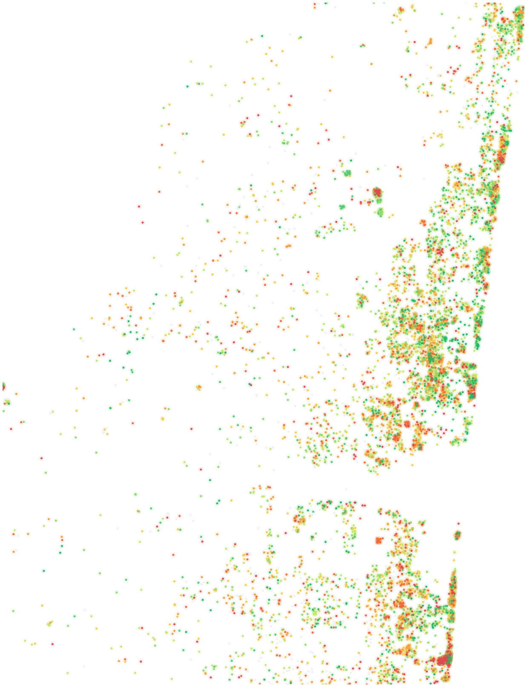

<!-- generated by tools/airbnb_build.py; do not edit by hand -->
```{=html}
    <a class="feature case-feature" href="airbnb.html">
      <div class="cf-body">
        <div class="pic map"></div>
        <ul class="stats cf-stats" aria-label="Key numbers, entire homes, as of 19 March 2025">
          <li class="stat"><span class="n">$57</span><span class="l">median RevPAR a night</span></li>
          <li class="stat"><span class="n">$21k</span><span class="l">median revenue a year</span></li>
          <li class="stat"><span class="n">21%</span><span class="l">reach $50k a year</span></li>
        </ul>
      </div>
      <div class="cap"><b>Broward Airbnb, the best and worst bets</b><span class="chip">As of 19 March 2025</span></div>
    </a>
```
