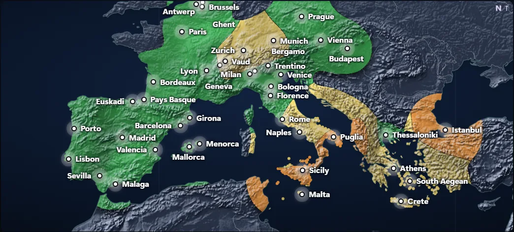

```{=html}
    <a class="feature case-feature" href="https://plotbot2023.github.io/rentals-archetypes/">
      <div class="cf-body">
        <div class="pic map"></div>
        <ul class="stats cf-stats" aria-label="Key numbers, as of 9 November 2026">
          <li class="stat"><span class="n">1.7M</span><span class="l">listings read and mapped</span></li>
          <li class="stat"><span class="n">124</span><span class="l">markets in 37 countries</span></li>
          <li class="stat"><span class="n">16</span><span class="l">types of listing, host and market</span></li>
        </ul>
      </div>
      <div class="cap"><b>Rentals Archetypes, worldwide</b><span class="chip">As of 9 November 2026</span></div>
    </a>
```
