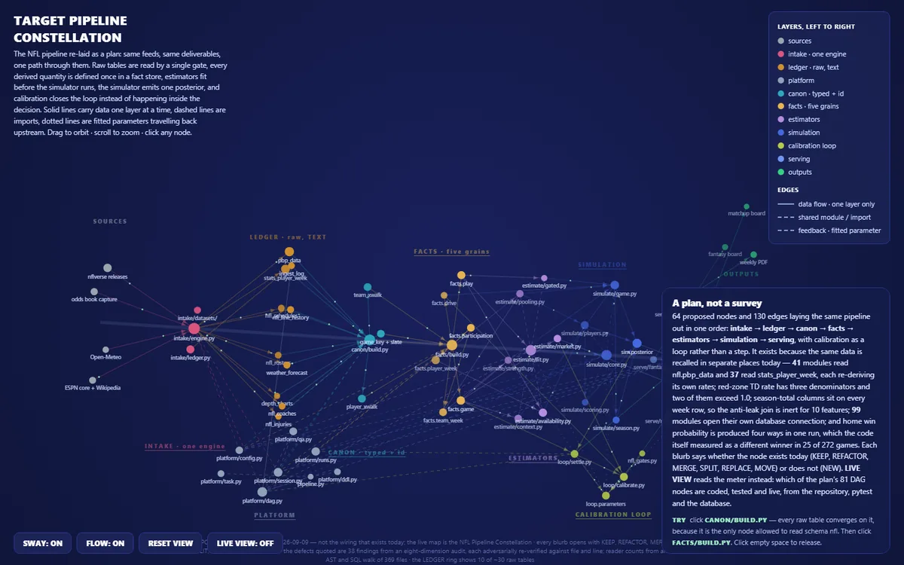
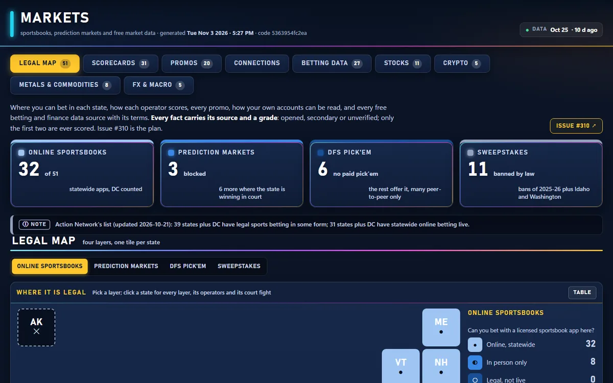

::: {.hero}
::: {.kicker}
Fort Lauderdale, FL
:::

# Richard Chute

::: {.tagline}
I build data pipelines and analyses that people actually make decisions from — Python and PostgreSQL on the back end, plain answers on the front. Fifteen years running field-service and distribution operations before I wrote the code, which is mostly why I care whether the number is right.
:::

::: {.cta}
[View the projects](projects.qmd){.primary}
[About me](about.qmd)
[Résumé](resume.qmd)
[GitHub](https://github.com/PlotBot2023)
:::

::: {.chips}
- Python
- PostgreSQL
- SQL
- pandas
- scikit-learn
- XGBoost / CatBoost
- Monte Carlo simulation
- Causal inference
- Docker
- R
- Jupyter
- Tableau / Power BI
:::
:::

## Selected work

A pipeline rebuilt from an audit of itself, a sourced map of a fast-moving legal market, and four quarters of Airbnb data turned into an investment answer. The first two run in a private platform, so they're described here; the notebook is public with its outputs intact.

::: {.cols2}
::: {}
{fig-alt="A dark constellation map of pipeline files grouped into labelled layers."}

### [The Target pipeline rebuild](projects.qmd#systems)

An audit of my own production pipeline turned into a plan, then into code: one intake engine, one typing gate, a fact store with declared grains, and calibration as a loop. Each layer has a live meter that climbs planned, coded, tested, live.

*Python · PostgreSQL · data contracts · 15 of 89 nodes live, 2026-11-08*
:::

::: {}
{fig-alt="A dark dashboard with headline tiles and a tile map of US states."}

### [Markets: a sourced legal map](projects.qmd#systems)

Where each kind of betting is legal, state by state, with 31 operator scorecards and every free finance API graded on its limits and terms. Every fact carries its source and a grade, and only verified facts are scored.

*Research · data governance · API terms review*
:::

::: {}
### [The Best and Worst Bets in the Broward Airbnb Market](notebooks/broward-investor-guide.ipynb)

17,000+ listings across four quarterly snapshots, reduced to a straight answer for an individual investor: what a Broward short-term rental actually earns, which neighborhoods clear their cost basis, and how much of the market is already corporate.

*Python · pandas · Inside Airbnb · four-snapshot panel*
:::

:::

[See every system, study and notebook →](projects.qmd)

## How I work

**Data is append-only.** Never `DROP`, never `TRUNCATE` — upsert and keep the history. A silent corruption costs more than a crash, because a crash tells you.

**Modelled is labelled modelled.** A metric that didn't exist in an era is "not measured," never zero-filled to look observed. A chart that reads well but overstates what was measured is a defect, not a rough edge.

**The output is an instrument, not a table.** The deliverable isn't the number — it's the thing someone opens, reads, and decides from.

::: {.note-box}
**A note on the code.** These notebooks are published with their saved outputs rather than re-executed on render — several of them read from a local PostgreSQL instance and licensed data exports that don't travel. Every page has its source available under "Show code," and the repository is [on GitHub](https://github.com/PlotBot2023/portfolio).
:::
