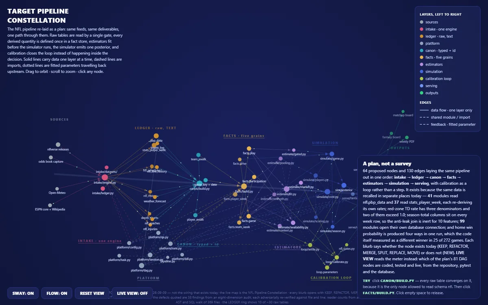
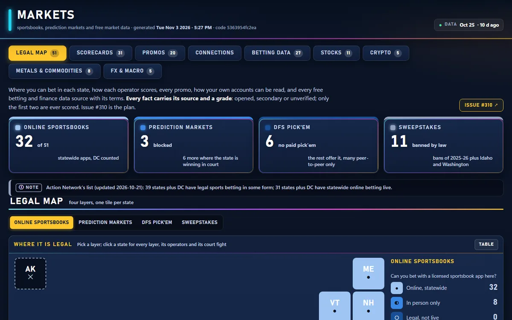
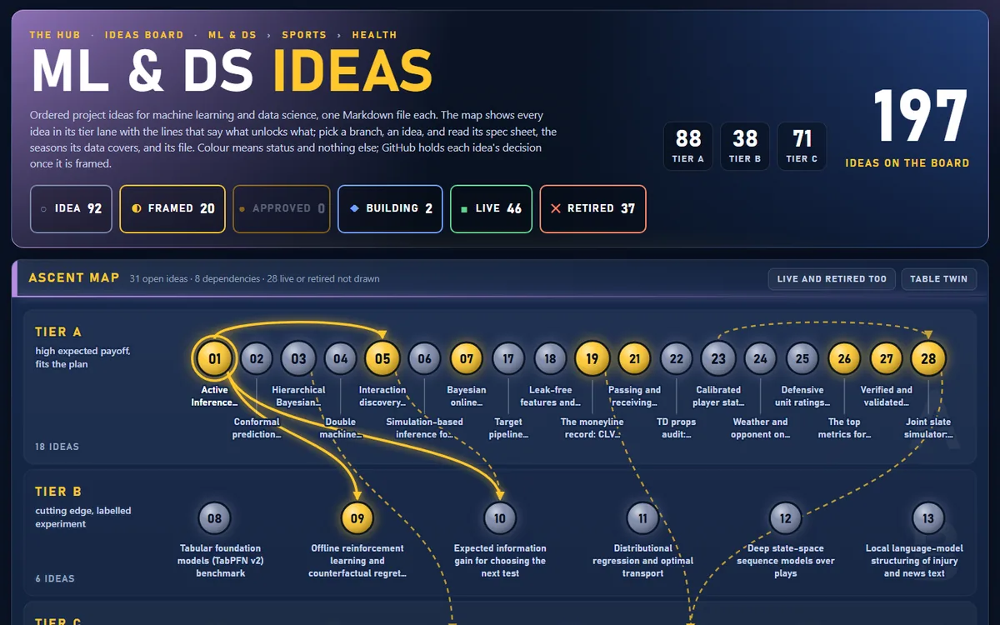
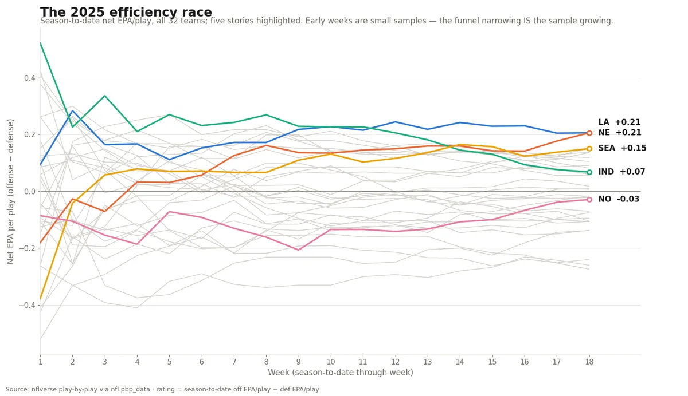
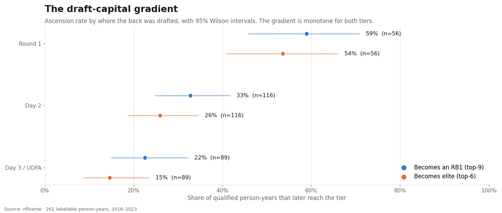

Most of my work lives in a private platform I build and run every day, so it can't all be one click away. The systems below are described as they stand, with a picture where a picture is safe to publish, and every number carries the date it was read. The **studies** are public and rebuild from their own folder. The **notebooks** at the foot of the page are complete, with code under "Show code."

A walkthrough of any private system is one email away: [plotbot2023@gmail.com](mailto:plotbot2023@gmail.com).

## Systems

::: {.sys-feature}
::: {.sys-shot}
{fig-alt="A dark constellation map of pipeline files grouped into labelled layers from sources on the left to outputs on the right."}
:::
::: {.sys-body}
[◐ Building]{.sys-status .building}

### The Target pipeline rebuild

An audit of my own production pipeline, turned into a plan and then into code. The audit found the same data recalled in many places, derived numbers defined more than once, and probabilities produced several ways in one run. The plan lays the pipeline out again as one path: a single intake engine, one typing gate, a fact store with declared grains, estimators before simulation, and calibration as a loop rather than a step.

Each layer has its own page with a live meter that climbs planned, coded, tested, live. The spine keeps its own run and QA record: every check with its value, baseline, sample size and threshold, plus rejected rows and data freshness.

::: {.sys-stats}
- [15 / 89]{.n} nodes live
- [816]{.n} tests on the plan
- [0]{.n} failing
:::

*Python · PostgreSQL · DAG orchestration · data contracts · as of 2026-11-08*
:::
:::

::: {.sys-feature .flip}
::: {.sys-shot}
{fig-alt="A dark dashboard with four headline tiles and a tile map of US states coloured by legal status."}
:::
::: {.sys-body}
[● Live]{.sys-status .live}

### Markets: a sourced map of legal betting and free market data

Where each kind of betting is legal, state by state, across four layers: online sportsbooks, prediction markets and their court fights, pick'em apps, and sweepstakes. Every operator gets a scorecard, z-scored within its kind. The same page catalogues every free odds, finance, crypto, commodity and macro API, with its limits on one scale and its terms in words.

The rule that makes it trustworthy: **every fact carries its source and a grade**, and only facts opened at the source or confirmed by a second one are ever scored. An API whose terms ban automated use is listed so you know, and never wired.

::: {.sys-stats}
- [51]{.n} states + DC mapped
- [31]{.n} operator scorecards
- [29]{.n} finance APIs graded
:::

*Research · data governance · API terms review · data as of 2026-10-25*
:::
:::

::: {.sys-feature}
::: {.sys-shot}
{fig-alt="A dark board titled ML and DS Ideas with status counts and an ascent map of numbered idea nodes linked by arrows."}
:::
::: {.sys-body}
[● Live]{.sys-status .live}

### The ML & DS ideas board

A research backlog run like a portfolio. Each idea is one Markdown file with a spec sheet: its baseline, the result that would falsify it, and the compute it needs. The board draws every idea in its tier lane with the lines that say what unlocks what, and shows which seasons each data source actually covers. An idea is coded only after its decision is written down and approved.

::: {.sys-stats}
- [197]{.n} ideas on the board
- [46]{.n} live
- [37]{.n} retired, kept with reasons
:::

*Experiment design · research planning · as of 2026-11-08*
:::
:::

::: {.sys-grid}

::: {.sys}
[● Live]{.sys-status .live}

### Review bench and judge trainer

Seventeen automated judges that every new view, restyle or pipeline change faces before its pull request: contrast, type floor, honesty labels, data checks. Each judge has numbered rules and tunable thresholds with their acceptable ranges. When I overrule a judge, the ruling is recorded and becomes training data for the next review.

*QA automation · Playwright · accessibility measurement*
:::

::: {.sys}
[● Live]{.sys-status .live}

### Data lineage, read from the code

Every external feed, loader, raw table, derived table and reader, mapped with a file and line number behind each node and edge, at three drill levels. A companion atlas profiles every raw column's values. Where a count needs the live catalogue, it reads "not measured" instead of a guess.

*Static analysis · data cataloguing · lineage*
:::

::: {.sys}
[◐ Building]{.sys-status .building}

### Pre-registered experiments

Tests that state their pass gate before they run and score their holdout once. One asks whether a game simulation beats the closing line by enough to matter. Another moves a traded or injured starter's share of team production with him, and enters the model only if the holdout errors improve.

*Experiment design · holdout testing · Monte Carlo*
:::

::: {.sys}
[● Live]{.sys-status .live}

### Writing console

A drafting desk for the publication below. Pick a story from the week's flagged movements, write the hook yourself, and the desk drafts the rest with a receipt on every number. Every figure, credit line and data-provider rule is checked before anything can be copied out, and nothing posts until I press.

*Content pipeline · provenance · Python*
:::

::: {.sys}
[◐ Building]{.sys-status .building}

### Political and corporate dashboard

One card per member of Congress, Fortune 500 executive and director, and Supreme Court justice, each with three key numbers. It traces the money from PACs to candidates and from agencies to contractors, and lists the most leveraged and most shorted companies. Each number carries its source and as-of date, and a feed that isn't wired yet says so.

*Public-records integration · entity resolution*
:::

::: {.sys}
[● Live]{.sys-status .live}

### Mise: household nutrition and training

A meal plan per person built from each profile's targets, a grocery list priced by aisle and by store, workouts by training phase, and a bloodwork page that turns a lab panel into plain words and a plan. It runs offline, because the data is a family's health.

*Single-file app · offline-first · nutrition modelling*
:::

::: {.sys}
[● Live]{.sys-status .live}

### Hot Wheels value field guide

How to identify, authenticate, grade and price a collectible car, generation by generation. Every feature is drawn and zoomed, the fake and restoration tells are listed, and a ranked watch list covers 500 rare pieces. Every value carries its source, basis and date.

*Market research · pricing · reference design*
:::

:::

## Studies

Public write-ups that rebuild end to end from the committed data in their own folder: no database, no trust required. A movement is only called a story if it clears a threshold measured against that team's own history, and null results are published as nulls. They're collected under **Stats Over Fiction**.

::: {.cols2}
::: {}
{fig-alt="Line chart of every NFL team's season-to-date efficiency across the 2025 season."}

### [The 2025 efficiency race](https://github.com/PlotBot2023/stats-over-fiction/blob/main/studies/power-trajectories-2025/post.md)

A season is a trajectory, not a table. All 32 teams' season-to-date efficiency, week by week, and the collapse that hid inside a top-10 finish.

*Python · nflverse · reproducible study*
:::

::: {}
{fig-alt="Chart of running-back breakout rates by draft round."}

### [Draft capital vs. athleticism](https://github.com/PlotBot2023/stats-over-fiction/blob/main/studies/draft-vs-athleticism/post.md)

What makes a running back break out: the draft-capital gradient, what speed score really adds, and the seven-player cell that answers the rescue question, shown with its sample size rather than trimmed.

*Python · nflverse · reproducible study*
:::
:::

[All studies on GitHub →](https://github.com/PlotBot2023/stats-over-fiction)

## Notebooks

Grouped roughly by what they demonstrate: the **Broward Airbnb** series is end-to-end analysis for a non-technical decision-maker; the **sports** notebooks come out of the private platform above; the **coursework** notebooks are labelled as such. They're from IBM and sports-analytics course tracks, kept here because the wrangling and visualization work is honest and legible.

::: {#project-listing}
:::
