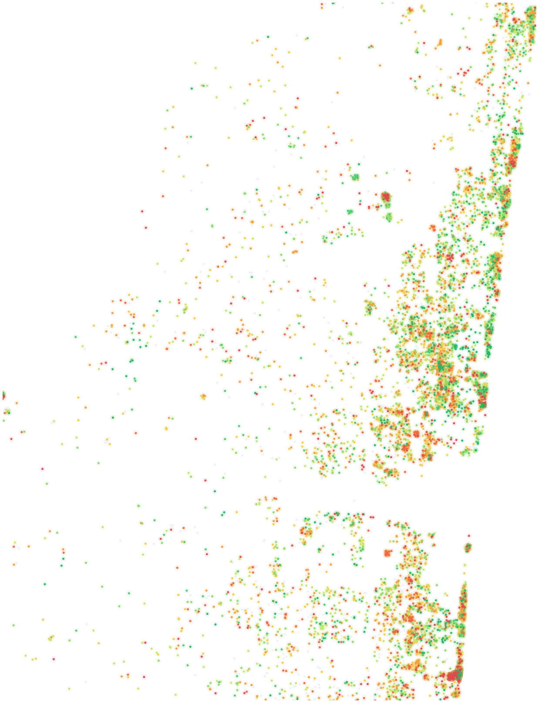

```{=html}
<div class="sv v-projects">

  <div class="top">
    <div class="tt">
      <span class="eyebrow">Projects</span>
      <h1 class="page-title">What I build and measure</h1>
    </div>
    <ul class="rail" aria-label="On this page" style="grid-column:auto">
      <li>3 projects</li><li>1 on the way</li>
    </ul>
  </div>

  <div class="bs">
    <div class="board one" data-stage="stage-pj" aria-label="Projects, pick one to show it">
      <button class="tile" type="button" data-item="airbnb" aria-pressed="true">
        <span class="mark"></span>
        <span class="tt"><span class="name">Broward Airbnb market study</span><span class="status live">Published</span></span>
      </button>
      <button class="tile" type="button" data-item="leaders" aria-pressed="false">
        <span class="mark"><svg viewBox="0 0 24 24" fill="none" stroke="currentColor" stroke-width="1.8" stroke-linecap="round" stroke-linejoin="round" aria-hidden="true" focusable="false"><path d="M4 20V11M10 20V5M16 20v-6M22 20H2"/><path d="M19 4l1.2 2.4 2.6.4-1.9 1.8.5 2.6L19 10l-2.4 1.2.5-2.6-1.9-1.8 2.6-.4z"/></svg></span>
        <span class="tt"><span class="name">Sports leaderboards and experiments</span><span class="status live">Live</span></span>
      </button>
      <button class="tile" type="button" data-item="hotwheels" aria-pressed="false">
        <span class="mark"><svg viewBox="0 0 24 24" fill="none" stroke="currentColor" stroke-width="1.8" stroke-linecap="round" stroke-linejoin="round" aria-hidden="true" focusable="false"><path d="M3 15v-3l2-4h9l4 4h3v3z"/><circle cx="7.5" cy="16" r="2"/><circle cx="17" cy="16" r="2"/></svg></span>
        <span class="tt"><span class="name">Hot Wheels value field guide</span><span class="status live">Live</span></span>
      </button>
      <button class="tile" type="button" data-item="netflix" aria-pressed="false">
        <span class="mark"><svg viewBox="0 0 24 24" fill="none" stroke="currentColor" stroke-width="1.8" stroke-linecap="round" stroke-linejoin="round" aria-hidden="true" focusable="false"><rect x="3" y="5" width="18" height="12" rx="2"/><path d="M8 21h8M12 17v4"/><path d="M10 9l4 2-4 2z"/></svg></span>
        <span class="tt"><span class="name">Netflix analysis</span><span class="status building">Coming next</span></span>
      </button>
    </div>

    <div class="stage" id="stage-pj">
      <article class="panel rail-top" data-item="airbnb" aria-label="Broward Airbnb market study">
        <div class="media inlay"></div>
        <div class="info">
          <div class="head"><h2>Broward Airbnb market study</h2><span class="status live">Published</span></div>
          <ul class="stats">
            <li class="stat"><span class="n">4</span><span class="l">quarterly snapshots</span></li>
            <li class="stat"><span class="n">4</span><span class="l">notebooks, end to end</span></li>
            <li class="stat"><span class="n">1</span><span class="l">straight answer for an investor</span></li>
          </ul>
          <div class="foot">
            <ul class="tray slim" aria-label="Methods"><li>Market analysis</li><li>Data quality</li><li>Clustering</li></ul>
            <div class="btn-row"><button class="btn" type="button" popovertarget="n-airbnb">Notes</button><a class="btn primary" href="airbnb.html">Open the case study</a></div>
          </div>
        </div>
      </article>

      <article class="panel rail-top" data-item="leaders" aria-label="Sports leaderboards and experiments">
        <div class="media inlay poster scoreline" aria-hidden="true">
          <div class="sl-row"><span class="sl-k">Value</span><span class="sl-bar"><span style="width:78%"></span></span><span class="sl-chip hot">Elite</span></div>
          <div class="sl-row"><span class="sl-k">Value</span><span class="sl-bar"><span style="width:56%"></span></span><span class="sl-chip warm">Good</span></div>
          <div class="sl-row"><span class="sl-k">Baseline</span><span class="sl-bar base"><span style="width:44%"></span></span><span class="sl-chip">Average</span></div>
          <div class="sl-row"><span class="sl-k">Value</span><span class="sl-bar"><span style="width:24%"></span></span><span class="sl-chip cold">Poor</span></div>
        </div>
        <div class="info">
          <div class="head"><h2>Sports leaderboards and experiments</h2><span class="status live">Live</span></div>
          <ul class="stats">
            <li class="stat"><span class="n">11</span><span class="l">sports, each with its own boards</span></li>
            <li class="stat"><span class="n">5</span><span class="l">boards a sport: basic, advanced, betting, accuracy, results</span></li>
            <li class="stat"><span class="n">30</span><span class="l">games before a row is ranked</span></li>
          </ul>
          <div class="foot">
            <ul class="tray slim" aria-label="Methods"><li>z-scores</li><li>Pre-registration</li><li>Holdout tests</li></ul>
            <div class="btn-row"><button class="btn" type="button" popovertarget="n-leaders">Leaderboards</button><button class="btn" type="button" popovertarget="n-experiments">Experiments</button></div>
          </div>
        </div>
      </article>

      <article class="panel rail-top" data-item="hotwheels" aria-label="Hot Wheels value field guide">
        <div class="media inlay poster"><svg viewBox="0 0 24 24" fill="none" stroke="currentColor" stroke-width="1.4" stroke-linecap="round" stroke-linejoin="round" aria-hidden="true" focusable="false"><path d="M3 15v-3l2-4h9l4 4h3v3z"/><circle cx="7.5" cy="16" r="2"/><circle cx="17" cy="16" r="2"/></svg></div>
        <div class="info">
          <div class="head"><h2>Hot Wheels value field guide</h2><span class="status live">Live</span></div>
          <ul class="stats">
            <li class="stat"><span class="n">500</span><span class="l">rare pieces on the watch list</span></li>
            <li class="stat"><span class="n">Every value</span><span class="l">with its source, basis and date</span></li>
          </ul>
          <div class="foot">
            <ul class="tray slim" aria-label="Methods"><li>Market research</li><li>Pricing</li><li>Reference design</li></ul>
            <div class="btn-row"><button class="btn" type="button" popovertarget="n-hotwheels">Notes</button><a class="btn primary" href="guides/hot-wheels-field-guide.html">Open the guide</a></div>
          </div>
        </div>
      </article>

      <article class="panel rail-top" data-item="netflix" aria-label="Netflix analysis, coming next">
        <div class="media inlay poster"><svg viewBox="0 0 24 24" fill="none" stroke="currentColor" stroke-width="1.4" stroke-linecap="round" stroke-linejoin="round" aria-hidden="true" focusable="false"><rect x="3" y="5" width="18" height="12" rx="2"/><path d="M8 21h8M12 17v4"/><path d="M10 9l4 2-4 2z"/></svg></div>
        <div class="info">
          <div class="head"><h2>Netflix analysis</h2><span class="status building">Coming next</span></div>
          <div class="foot"><ul class="tray slim" aria-label="Status"><li>In progress</li></ul></div>
        </div>
      </article>
    </div>
  </div>
</div>

<div id="n-airbnb" popover class="note">
  <h3>Broward Airbnb market study</h3>
  <p>Four quarterly Inside Airbnb snapshots of Broward County, reduced to a straight answer for an individual investor: what an entire-home rental actually earns, which neighbourhoods clear their cost basis, and how much of the market multi-listing hosts already hold.</p>
  <p>Four notebooks carry it end to end: the market itself, a data-quality decision memo, a segmentation by mixture models, and the investor guide.</p>
  <div class="btn-row"><a class="btn primary" href="airbnb.html">Open the case study</a><button class="btn" popovertarget="n-airbnb" popovertargetaction="hide">Close</button></div>
</div>
<div id="n-leaders" popover class="note">
  <h3>Leaderboards</h3>
  <p>Every sport gets its own leaderboards: basic stats, advanced stats, betting, accuracy and results. Each row is scored against a stated baseline (the league mean, a coin flip, break-even, or the market) and its z-score sets the heat colour, so a number always reads against something.</p>
  <p>Small samples are held back: a row under 30 games is never ranked or coloured. Early in a season the board shows early leaders instead, labelled as early. Every board has a table twin with every row and its notes.</p>
  <button class="btn" popovertarget="n-leaders" popovertargetaction="hide">Close</button>
</div>
<div id="n-experiments" popover class="note">
  <h3>Pre-registered experiments</h3>
  <p>Each test writes down its question, data, seasons and pass mark before it runs, and scores its holdout once. A test passes only if it beats its baseline and the market by enough to matter.</p>
  <p>Each one ships as a report: the question and verdict with one hero number, what was tested, the results, the checks against the baseline, the market and the holdout, what it means, the limits, and a table twin for every chart. Recent questions: whether pass-rush pressure adds points beyond the box score, and whether a starter's share of production moves with him after a trade or injury.</p>
  <button class="btn" popovertarget="n-experiments" popovertargetaction="hide">Close</button>
</div>
<div id="n-hotwheels" popover class="note">
  <h3>Hot Wheels value field guide</h3>
  <p>How to identify, authenticate, grade and price a collectible car, generation by generation. Every feature is drawn and zoomed, the fake and restoration tells are listed, and a ranked watch list covers 500 rare pieces. Every value carries its source, basis and date.</p>
  <div class="btn-row"><a class="btn primary" href="guides/hot-wheels-field-guide.html">Open the guide</a><button class="btn" popovertarget="n-hotwheels" popovertargetaction="hide">Close</button></div>
</div>

<script src="assets/sv.js"></script>
```
